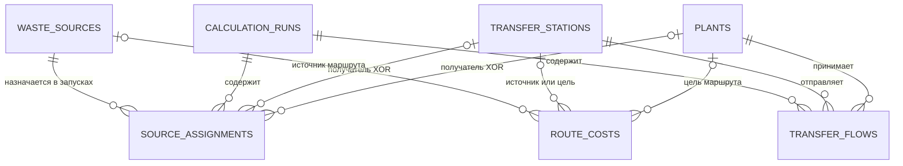

# Модель данных PostgreSQL/PostGIS

## Область этапа

Документ описывает проект БД для существующего файлового конвейера
оптимизации обращения с отходами. Проектирование основано на фактических
Go-моделях, MATLAB-модели и текущих CSV-контрактах.

SQL-описание находится в
[`migrations/000001_initial_schema.sql`](../migrations/000001_initial_schema.sql).

Границы текущей интеграции:

- приложение не подключается к PostgreSQL;
- Go- и MATLAB-бизнес-логика не меняется;
- начальная миграция запускается автоматически при создании Compose-volume;
- CSV, JSON и GeoJSON остаются единственным рабочим сценарием.

## Основные решения

1. Все внешние предметные ID имеют тип `text`. В Go они представлены
   строками, а ID МПС и заводов в контрольном наборе пересекаются (`1`–`4`).
2. Координаты хранятся только в `geom geometry(Point, 4326)`. Отдельные
   `latitude` и `longitude` в БД не создаются, чтобы не дублировать геометрию.
3. Вещественные значения хранятся как `double precision`, как в Go
   (`float64`), Valhalla и MATLAB. Ограничения запрещают отрицательные
   значения, `NaN` и бесконечности там, где они недопустимы.
4. Полиморфные ссылки маршрутов и назначений представлены типизированными
   nullable-FK. Это дает настоящую ссылочную целостность без дополнительной
   таблицы-регистра объектов и без слабой пары `type + id`.
5. Результаты оптимизации принадлежат конкретному `calculation_runs.run_id`.
6. Имена объектов в результатах не копируются: они получаются через `JOIN`.
7. Снимки объема и расстояния в результатах сохраняются намеренно, чтобы
   исторический расчет не изменился после обновления исходных объектов или
   повторного расчета маршрутов.
8. `transport_cost` вычисляется самой БД как
   `waste_amount * distance_km` и не может расходиться с этими значениями.

## ER-схема

Для каждого `source_assignments` заполнен ровно один получатель: МПС или
завод. Для каждого `route_costs` разрешено ровно одно из направлений:

- площадка → МПС;
- площадка → завод;
- МПС → завод.

## Таблицы

### `waste_sources` — контейнерные площадки

Таблица соответствует фактической Go-модели `WasteSource` и файлу
`data/prepared/waste_sources.csv`.

| Поле | Назначение |
|---|---|
| `id text` | Первичный ключ, исходный строковый ID площадки |
| `service_zone text` | Сервисная зона |
| `address text` | Адрес; обязательный и непустой |
| `district text` | Район |
| `waste_type text` | Тип отходов |
| `container_type text` | Тип контейнера |
| `container_volume_m3 double precision` | Объем контейнера, м³; больше нуля |
| `container_count integer` | Число контейнеров; больше нуля |
| `waste_amount double precision` | Годовой объем отходов, тонн; больше нуля |
| `pickups_warm_period double precision` | Вывозы в теплом периоде; может быть `NULL` |
| `pickups_cold_period double precision` | Вывозы в холодном периоде; может быть `NULL` |
| `geom geometry(Point, 4326)` | Координаты WGS84 |

Один из периодов вывоза может быть неизвестен: существующий Go-reader в этом
случае использует значение второго периода для расчета годового объема.
Поэтому эти два поля nullable, но хотя бы одно должно быть задано.

Ограничения геометрии запрещают пустую или некорректную точку и проверяют
долготу `[-180, 180]` и широту `[-90, 90]`.

### `transfer_stations` — МПС

| Поле | Назначение |
|---|---|
| `id text` | Первичный ключ МПС |
| `name text` | Непустое название |
| `capacity double precision` | Мощность, тонн/год; больше нуля |
| `geom geometry(Point, 4326)` | Координаты WGS84 |

### `plants` — заводы и КПО

| Поле | Назначение |
|---|---|
| `id text` | Первичный ключ завода |
| `name text` | Непустое название |
| `capacity double precision` | Мощность, тонн/год; больше нуля |
| `geom geometry(Point, 4326)` | Координаты WGS84 |

Названия, адреса и геометрии не имеют `UNIQUE`: разные предметные объекты
могут находиться по одному адресу, иметь одинаковое название или совпадающие
координаты.

### `route_costs` — результаты Valhalla

`route_costs` заменяет широкие матрицы тремя наборами реляционных записей.

| Поле | Назначение |
|---|---|
| `route_cost_id bigint` | Суррогатный PK |
| `source_waste_source_id text` | Nullable-FK исходной площадки |
| `source_transfer_station_id text` | Nullable-FK исходной МПС |
| `target_transfer_station_id text` | Nullable-FK целевой МПС |
| `target_plant_id text` | Nullable-FK целевого завода |
| `source_type text` | Generated: `waste_source` или `transfer_station` |
| `target_type text` | Generated: `transfer_station` или `plant` |
| `costing_model text` | Модель стоимости Valhalla, например `auto` |
| `distance_km double precision` | Расстояние в километрах |
| `travel_time_seconds double precision` | Время движения в секундах |
| `reachable boolean` | Признак достижимости |
| `status text` | `ok`, `unreachable` или `error` |
| `error_message text` | Диагностика для статуса `error` |
| `calculated_at timestamptz` | Время получения результата |

При `reachable = true` расстояние и время обязательны. При недостижимости
оба значения равны `NULL`; при обратном CSV-экспорте такой маршрут становится
`NaN`.

Три частичных `UNIQUE`-индекса запрещают повтор одной пары для одного
`costing_model` отдельно по каждому направлению. Они же являются ключами
будущего кэша Valhalla.

Обычная структура `source_type, source_id, target_type, target_id` не
используется как единственный физический ключ: PostgreSQL не может создать
FK из одной такой пары сразу в три разные таблицы. Типизированные FK плюс
`CHECK` обеспечивают существование каждого объекта и исключают запрещенные
направления.

### `calculation_runs` — запуски оптимизации

| Поле | Назначение |
|---|---|
| `run_id bigint` | Identity PK запуска |
| `description text` | Пользовательское описание сценария |
| `status text` | `pending`, `running`, `succeeded` или `failed` |
| `parameters jsonb` | Параметры и изменения входного сценария |
| `created_at timestamptz` | Время создания записи |
| `started_at timestamptz` | Фактический старт расчета |
| `finished_at timestamptz` | Завершение расчета |
| `objective_value double precision` | Значение целевой функции |
| `solver_exit_flag integer` | Код завершения `intlinprog` |
| `solve_time_seconds double precision` | Время работы решателя |
| `solver_metadata jsonb` | Дополнительный вывод решателя |
| `error_message text` | Ошибка неуспешного запуска |

`parameters` и `solver_metadata` должны быть JSON-объектами. `CHECK`
контролирует согласованность статуса, временных полей, целевой функции и
ошибки.

Отдельная таблица для текущего `summary.csv` не создается:

- `objective_value` хранится в `calculation_runs`;
- сведения решателя хранятся в явных полях и `solver_metadata`;
- количества, мощности и суммы рассчитываются агрегатами по основным
  таблицам и результатам.

### `source_assignments` — назначения площадок

| Поле | Назначение |
|---|---|
| `run_id bigint` | FK запуска с `ON DELETE CASCADE` |
| `waste_source_id text` | FK площадки |
| `destination_transfer_station_id text` | Nullable-FK МПС-получателя |
| `destination_plant_id text` | Nullable-FK завода-получателя |
| `assignment_type text` | Generated: `transfer_station` или `plant` |
| `waste_amount double precision` | Снимок объема площадки в запуске |
| `distance_km double precision` | Снимок использованного расстояния |
| `transport_cost double precision` | Generated: объем × расстояние |

Составной PK `(run_id, waste_source_id)` гарантирует ровно одно назначение
площадки в одном запуске. `CHECK num_nonnulls(...) = 1` гарантирует выбор
ровно одного типа получателя.

`destination_name` не хранится: он получается через `JOIN` с МПС или
заводом. Совместимый `destination_id` получается через `COALESCE` двух FK.

### `transfer_flows` — потоки МПС → завод

| Поле | Назначение |
|---|---|
| `run_id bigint` | FK запуска с `ON DELETE CASCADE` |
| `transfer_station_id text` | FK исходной МПС |
| `plant_id text` | FK целевого завода |
| `waste_amount double precision` | Положительный объем потока |
| `distance_km double precision` | Снимок использованного расстояния |
| `transport_cost double precision` | Generated: объем × расстояние |

Составной PK `(run_id, transfer_station_id, plant_id)` допускает не более
одного агрегированного потока для пары МПС–завод в одном запуске. Нулевые
потоки не сохраняются, что соответствует текущему `decode_solution.m`.

## Связи и правила удаления

| Связь | Кардинальность | Правило |
|---|---:|---|
| `calculation_runs` → `source_assignments` | 1:N | Удаление запуска каскадно удаляет его назначения |
| `calculation_runs` → `transfer_flows` | 1:N | Удаление запуска каскадно удаляет его потоки |
| `waste_sources` → `source_assignments` | 1:N | Удаление используемой площадки запрещено |
| МПС/заводы → назначения | 1:N | Удаление используемого получателя запрещено |
| МПС/заводы → потоки | 1:N | Удаление используемого объекта запрещено |
| Объекты → `route_costs` | 1:N | Удаление объекта с маршрутами запрещено |

Обновление предметного ID каскадируется в зависимые таблицы. Удаление
`calculation_runs` безопасно ограничено только результатами этого запуска.

## Индексы

- PK B-tree для всех объектных таблиц и запусков.
- GiST по `geom` для площадок, МПС и заводов.
- B-tree `(service_zone, district)` для фильтрации большого набора площадок.
- Три частичных уникальных индекса для направлений `route_costs`.
- Индекс выбора матриц по типам, `costing_model` и достижимости.
- Обратные индексы FK для истории объекта и эффективной проверки удаления.
- Индекс запусков `(status, created_at DESC)`.
- PK результатов начинаются с `run_id` и поддерживают получение полного
  результата конкретного запуска.

GIN-индексы по JSONB и партиционирование пока не предусмотрены: для текущего
объема они не дают оправданного выигрыша.

## Совместимость с файловым сценарием

| Файловое представление | Представление в БД |
|---|---|
| `latitude` | `ST_Y(geom)` |
| `longitude` | `ST_X(geom)` |
| Ячейка матрицы с расстоянием | Строка `route_costs` с `reachable = true` |
| `NaN` в матрице | `reachable = false`, расстояние и время `NULL` |
| `assignment_type` | Generated `source_assignments.assignment_type` |
| `destination_id` | `COALESCE(destination_transfer_station_id, destination_plant_id)` |
| Имена в CSV результата | `JOIN` с `transfer_stations` или `plants` |
| `transport_cost` | Generated произведение объема и расстояния |
| `summary.csv` | Поля запуска и агрегаты результатов |

SQL-запросы обязаны задавать порядок ID явно: порядок строк в реляционной
таблице не гарантирован, а MATLAB проверяет точное соответствие порядка
объектов строкам и столбцам матриц.

## Границы будущей реализации

- При изменении `geom` существующие маршруты необходимо инвалидировать или
  явно пересчитывать; это относится к этапу сохранения Valhalla в БД.
- Если появятся дополнительные параметры Valhalla, влияющие на маршрут,
  их идентификатор потребуется включить в уникальный ключ маршрутного кэша.
- Представления для прямого подключения QGIS и фильтрации по `run_id`
  относятся к отдельному этапу и сейчас не создаются.
- Драйвер PostgreSQL, пул соединений и repository пока не реализуются.
  Развертывание БД описано в
  [`database_deployment.md`](database_deployment.md).
